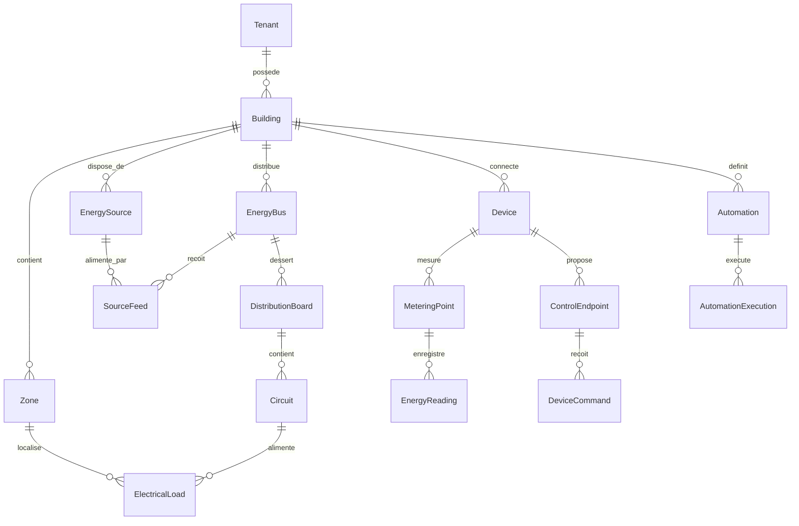

# AFRIXORA Energy Management V2
## Cahier de conception technique — Architecture fonctionnelle unifiée

**Statut :** Proposition d'architecture validée sur le principe, à vérifier avant intégration.
**Date :** 21 novembre 2026
**Périmètre :** conception seulement, aucune modification du dépôt ou de la production.
**Référence publique inspectée :** https://github.com/nazgenixDev/afrixora-platform/blob/main/backend/prisma/schema.prisma

---

## 1. Vision et objectifs

Transformer la gestion énergétique d'AFRIXORA en un système cohérent permettant :
1. de connaître **d'où vient** l'énergie (SNEL, groupe, photovoltaïque, batterie, onduleur) ;
2. de comprendre **par où elle passe** (chemins d'alimentation, inverseurs, jeux de barres, tableaux, départs) ;
3. de mesurer **où elle est consommée** (points de mesure et charges) ;
4. de commander **ce qui est effectivement pilotable** (endpoint matériel autorisé) ;
5. d'automatiser **sans compromettre la sécurité électrique** ;
6. de calculer dépenses, économies estimées, incidents, carburant et maintenance.

Ne pas créer huit applications séparées : conserver un module métier « Energy Management » composé de services spécialisés et d'une interface commune.

## 2. Inventaire du schéma actuel vérifié

Le fichier `backend/prisma/schema.prisma` expose :
- `Tenant` : organisation cliente ;
- `Building` : bâtiment relié à `Tenant` ;
- `Zone` : zone reliée à `Building` ;
- `Device` : objet IoT avec type, protocole, configuration, localisation et connectivité ;
- `DeviceState` : **un seul état courant par `Device`**, avec `deviceId @unique` ;
- `Automation` : règle avec `trigger`, `conditions`, `action` stockés en JSON ;
- `Alert`, `Gateway`, `User`, `ApiKey` et historiques d'abonnement.

Il n'y a pas, dans **ce schéma inspecté**, de représentation explicite de `Circuit`, `EnergySource`, `MeteringPoint` ou `DeviceCommand`. Cette observation ne prouve pas l'absence de toute logique métier correspondante dans les services applicatifs.

**Point sécurité à auditer :** dans le ZIP `main` fusionné reçu le 21 novembre 2026, le modèle `ApiKey` contient `keyHash String @unique` et `keyPrefix`, et non l’ancien champ `key`. La présence du hash dans le schéma ne suffit pas à prouver que la génération, la vérification et la rotation des clés sont entièrement sûres : contrôler les services, les API, les droits par tenant et les clés de démonstration. Revérifier la version Git locale avant de conclure.

## 3. Modèle conceptuel cible

**Note :** ce diagramme schématise la structure des données, pas un schéma de câblage. Il ne suffit pas à vérifier les verrouillages, calibres, protections ou conditions de couplage de sources.

### Distinction fondamentale

- `ElectricalLoad` : charge physique à gérer (pompe, climatiseur, frigo, lumière, machine), **même si elle n'est pas connectée**.
- `Device` : capteur, compteur, passerelle, thermostat, contrôleur ou autre équipement IoT déclaré dans AFRIXORA.
- `MeteringPoint` : point où la consommation ou la production est mesurée, lié au compteur/Device approprié.
- `ControlEndpoint` : interface physique capable d'une commande déterminée, associée à un `Device` et à **une cible autorisée**.

Pour lier un appareil logique à plusieurs dispositifs IoT, prévoir une relation `LoadDeviceBinding` (`loadId`, `deviceId`, `role`) après validation des usages ; une simple référence unique ne permettrait pas compteur + capteur + actionneur.

## 4. Contrats des entités majeures

### 4.1 `EnergySource`
Champs minimaux : `id`, `tenantId`, `buildingId`, `name`, `type` (`GRID`, `GENERATOR`, `PV_INVERTER`, `BATTERY_INVERTER`, `OTHER`), `ratedPowerW`, `status`, `configuration`, `createdAt`.

La production PV, la batterie et la sortie onduleur ne sont pas nécessairement des sources électriques indépendantes. Représenter les chemins réels et les possibilités d'alimentation simultanée plutôt que de déduire la source active de la seule présence de tension.

### 4.2 `EnergyBus` et `SourceFeed`
- `EnergyBus` : point de distribution ou bus alimentant un tableau, avec `tenantId`, `buildingId`, `name`.
- `SourceFeed` : association source → bus, lien vers l'organe de commutation ou l'inverseur lorsqu'il existe, état mesuré, autorisation de chemin, horodatage.

Pour un ATS SNEL/groupe, les interverrouillages et le transfert de puissance restent gérés matériellement. AFRIXORA observe les états et ne remplace pas les sécurités certifiées.

### 4.3 `DistributionBoard`
Champs : `id`, `tenantId`, `buildingId`, `busId`, `name`, `location`, `nominalVoltage`, `phaseConfiguration`.

### 4.4 `Circuit`
Champs : `id`, `tenantId`, `buildingId`, `boardId`, `parentCircuitId?`, `name`, `phases`, `ratedCurrentA`, `priority`, `criticality`, `autoSheddingAllowed=false`, `status`, `createdAt`.

Deux circuits ne doivent pas partager le même code dans un même bâtiment sans politique d'identifiants explicite. Les circuits vitaux ou de protection sont non pilotables par défaut.

### 4.5 `ElectricalLoad`
Champs : `id`, `tenantId`, `buildingId`, `zoneId?`, `circuitId`, `name`, `category`, `ratedPowerW?`, `priority`, `canBeAutomated=false`, `minOnSeconds?`, `minOffSeconds?`, `maxInterruptionsPerHour?`, `createdAt`.

Distinguer puissance **nominale** et puissance **mesurée**, et enregistrer les contraintes spécifiques de compresseurs, pompes, machines ou équipements médicaux.

### 4.6 `MeteringPoint` et `EnergyReading`
- `MeteringPoint` : `id`, `tenantId`, `buildingId`, `deviceId`, `scope` (`SOURCE`, `FEED`, `BOARD`, `CIRCUIT`, `LOAD`), référence vers la cible correspondante, sens du flux, calibration, statut de validation.
- `EnergyReading` : `tenantId`, `pointId`, `capturedAt`, `receivedAt`, `bootId`, `sequence`, `powerW?`, `energyImportWh?`, `energyExportWh?`, `voltageV?`, `currentA?`, `frequencyHz?`, `quality` (`MEASURED`, `ESTIMATED`, `INVALID`).

Une contrainte SQL ou de domaine doit assurer que le point mesure **exactement une portée**. Utiliser des types de grande précision et une politique explicite pour les remises à zéro/retours arrière de compteurs cumulés. Stocker les dates de mesure et de réception séparément. Dédupliquer par appareil/boot/séquence. La granularité, l'indexation et la création d'hypertables TimescaleDB doivent être validées sur une base de test.

**Double comptage :** les 100 kWh du compteur général et les 40 kWh d'un sous-compteur font partie d'un même ensemble ; ils ne doivent pas être additionnés comme 140 kWh pour le bâtiment.

### 4.7 `ControlEndpoint` et `DeviceCommand`

**Attention — deux étapes différentes :** le patch de stabilisation P0+V2 propose un `DeviceCommand` **transitoire**, lié directement à `deviceId`, avec les états `PENDING`, `SENT`, `ACKNOWLEDGED`, `CONFIRMED`, `FAILED`, `EXPIRED`, `REJECTED`. Le **modèle cible décrit ci-dessous** ajouterait notamment `ControlEndpoint`, `endpointId`, la gestion d'idempotence et un état vérifié. Ne pas recréer ou écraser la table intermédiaire : concevoir sa migration additive après inspection du code réellement fusionné.

Dans le patch intermédiaire, un `CONFIRMED` peut être déclaré par un message du dispositif accompagné d'un état logiciel. **Ce n'est pas une preuve indépendante de la position physique d'un contacteur**. Tant qu'un retour matériel fiable n'est pas validé, l'interface doit présenter ce résultat comme *état déclaré par le boîtier*, pas comme *état physique vérifié*. Les fonctions de puissance restent désactivées.
- `ControlEndpoint` : `id`, `tenantId`, `deviceId`, `targetCircuitId?`, `targetLoadId?`, `allowedActions`, `controlProtocol`, `safetyClass`, `isEnabled=false`, `verificationMethod`, `constraints`.
- `DeviceCommand` : `id`, `tenantId`, `endpointId`, `requestedByUserId?`, `automationId?`, `origin`, `action`, `parameters`, `idempotencyKey`, `expectedStateVersion?`, `expiresAt`, `status`, `requestedAt`, `sentAt?`, `acknowledgedAt?`, `verifiedAt?`, `failureReason?`, `correlationId`.

Contraindre la cible à une seule charge ou un seul circuit. Les endpoints ne commandent que des sorties physiquement prévues et validées. Interdire tout accès direct MQTT depuis un navigateur ; l'API autorisée arbitre les demandes.

États recommandés : `PENDING` → `SENT` → `ACKNOWLEDGED` → `VERIFIED`, avec sorties `REJECTED`, `FAILED`, `EXPIRED`, `CANCELED`.

L'accusé de réception IoT ne prouve pas que la charge s'est effectivement arrêtée : prévoir un retour de position, une télémétrie ou un état `UNVERIFIED` si aucune mesure fiable n'existe.

### 4.8 `Automation` existant et `AutomationExecution`
Conserver `Automation.trigger`, `.conditions`, `.action` en JSON sous un contrat versionné et validé côté serveur ; compléter avec des champs de priorité, contrôle d'activation et stratégie hors ligne si nécessaire.

Créer `AutomationExecution` : `id`, `tenantId`, `automationId`, `triggeredAt`, `inputSnapshot`, `decision`, `commandsCreated`, `status`, `failureReason`.

La priorité de décision doit être explicite : **protection matérielle > verrouillage local de maintenance > restrictions du site et autorisations > commande manuelle autorisée > règle automatique > optimisation économique**.

### 4.9 Tarifs et coûts
Prévoir `EnergyTariff` (`currency`, `unitPrice`, `effectiveFrom`, `effectiveTo`, `sourceId`, `billingMethod`) et, pour les groupes, `FuelPrice`, coût d'entretien horaire et quantité de carburant mesurée ou estimée.

Utiliser `Decimal` pour l'argent, pas `Float`. Enregistrer la date et la source du taux USD/CDF utilisé. Afficher « coût mesuré », « coût calculé selon tarif » ou « coût estimé », selon la qualité des données et l'origine des consommations.

## 5. Commande sécurisée — cycle de vie

1. L'utilisateur ou une automatisation soumet une intention (ex. arrêter un circuit flexible).
2. L'API authentifie, contrôle `tenantId`, bâtiment, rôle, permission fine et état de l'endpoint.
3. Vérifier priorité, classe de sécurité, délai de validité, état mesuré, verrouillage local et contraintes d'exploitation.
4. Inscrire la commande et son événement d'envoi dans la base (stratégie transactionnelle/outbox).
5. Transmettre par MQTT sécurisé sur des topics isolés ; ne jamais persister des commandes dangereuses comme messages MQTT retained.
6. L'agent local réévalue la validité, l'expiration et les interverrouillages. Il refuse plutôt que d'exécuter une commande obsolète.
7. Journaliser accusé, réponse et retour d'état réel. Notifier l'utilisateur en cas d'échec ou d'absence de preuve d'exécution.

**Résilience :** les commandes à effet matériel doivent être idempotentes, expirer, être journalisées et ne pas être rejouées aveuglément après une panne Internet. MQTT QoS 1 peut livrer des doublons ; l'idempotence métier reste nécessaire.

## 6. Gestion des automatisations

Exemple de scénario **non déployé** : en fonctionnement sur groupe et avec consommation supérieure au seuil configuré pendant une durée mesurée, proposer une réduction des charges flexibles. En mode automatique, ne déclencher que les circuits approuvés et munis de dispositifs adaptés ; respecter les périodes minimales de fonctionnement/repos et la puissance disponible.

Conditions minimales avant activation :
- mode simulation (« dry-run ») avec explication de chaque décision ;
- possibilité de désactiver le scénario ;
- limitation d'actions par heure et prévention des oscillations ;
- réponse sûre à une mesure invalide ou trop ancienne ;
- comportement de sécurité déterministe hors connexion ;
- validation technique de l'installation réelle.

## 7. API REST proposées (noms indicatifs)

| Méthode | Route cible | Description |
|---|---|---|
| `GET` | `/api/v2/buildings/:id/energy/topology` | Topologie des sources, bus, tableaux, circuits et charges |
| `POST` | `/api/v2/energy/sources` | Créer une source pour le tenant autorisé |
| `POST` | `/api/v2/energy/boards` | Déclarer un tableau |
| `POST` | `/api/v2/energy/circuits` | Déclarer un départ, sa criticité et ses protections |
| `POST` | `/api/v2/energy/loads` | Déclarer une charge physique |
| `GET` | `/api/v2/energy/measurements` | Consulter les mesures filtrées par tenant/site/période |
| `POST` | `/api/v2/control-endpoints/:id/commands` | Déclencher une commande autorisée et idempotente |
| `GET` | `/api/v2/commands/:id` | Consulter statut et preuve d'exécution |
| `POST` | `/api/v2/automations/:id/simulate` | Simuler sans agir |
| `GET` | `/api/v2/energy/costs` | Consommation et coûts par source/période |

Ces routes sont des **propositions** ; harmoniser les chemins avec les conventions des routes existantes avant implémentation. Validation serveur stricte, pagination, quotas, traçabilité et permissions fines obligatoires.

## 8. IoT et fonctionnement hors connexion

- Contrôleur local : stockage persistant en file circulaire, RTC/synchronisation temps, horodatage, compteur de séquence et identifiant de redémarrage (`bootId`).
- Envoi télémétrie : `tenantId`, `deviceId`, `bootId`, `sequence`, `capturedAt`, `measurements`, `schemaVersion`, contrôles d'intégrité appropriés.
- Reconnexion : synchronisation par lots avec confirmation et déduplication côté serveur ; ne pas supprimer un lot avant acquittement applicatif.
- Contrôle : règles de sécurité vitales traitées localement et indépendamment du cloud. Le backend ne doit pas devenir une protection électrique.
- Sécurité : TLS, identifiants uniques par passerelle/appareil, ACL MQTT minimales, provisionnement/révocation, mises à jour firmware vérifiées.

## 9. Sécurité, confidentialité et contraintes physiques

- Isolation du tenant sur toutes les lectures/écritures, notamment via contraintes de références et contrôles applicatifs ; vérifier que les IDs liés appartiennent au même tenant **et au même bâtiment**.
- Ne pas déduire les droits d'action du seul rôle global : permissions par site et classe d'équipement.
- Équipements essentiels ou dangereux : lecture et alerte par défaut, contrôle distant désactivé.
- Interverrouillage SNEL/groupe, protections électriques, contacteurs, dispositifs de sectionnement et mise en service : conception/validation par professionnel qualifié selon normes applicables.
- Prévoir journal d'audit des interventions et une procédure locale de neutralisation des automatismes (maintenance, urgence, litige).
- Pour la facturation et le prépaiement : compteurs et exigences réglementaires adaptés, validation indépendante des notifications de paiement et gestion des transactions idempotentes ; aucune coupure automatique commerciale sans conformité et politique de continuité appropriées.

## 10. Migration non destructive

### Lot 0 — Audit (sans modification)
Inventorier routes, services, topics MQTT, types de `Device`, automatisations JSON, workflows existants ; analyser la compatibilité des schémas et identifier les données réelles à migrer. Vérifier la sécurité des `ApiKey` et des comptes de démonstration.

### Lot 1 — Données (additif, en staging)
Créer les tables `EnergySource`, `EnergyBus`, `SourceFeed`, `DistributionBoard`, `Circuit`, `ElectricalLoad` et tables d'association, avec FK/index/contrôles de tenant. Ajouter les relations inverses nécessaires à Prisma. Ne pas renommer ni supprimer les modèles existants.

### Lot 2 — Mesures
Créer points de mesure et historique, adapter la collecte MQTT, gérer rétrocompatibilité, déduplication et tests d'intégrité des séries temporelles. Migrer les usages existants par correspondance explicite ; ne pas inventer de circuit/source manquants.

### Lot 3 — Automatisation en observation
Introduire `AutomationExecution` et simulateur de règles ; journaliser ce que la plateforme **aurait** fait sans envoyer de commandes physiques.

### Lot 4 — Pilotage limité
Installer des endpoints de contrôle pilotes sur des charges **non critiques**, après validation terrain ; introduire commandes expirables, vérification d'exécution, journal d'audit, permissions fines et interrupteur de désactivation.

### Lot 5 — Services avancés
Tarifs, coûts et rapports, carburant, maintenance, prépaiement éventuel après validation réglementaire et commerciale.

**Exécution des migrations :** développer et tester les migrations avec Prisma sur une base locale/staging. Pour la production, déployer les migrations contrôlées avec `prisma migrate deploy`, après sauvegarde/restauration testées et revue des scripts SQL ; ne pas utiliser `db push` pour transformer une base de production sensible.

## 11. Critères d'acceptation V2

1. Un équipement non connecté peut être créé et classé sur un circuit ; on peut lui associer un boîtier ultérieurement.
2. Un changement de source SNEL → groupe est enregistré selon un état de transfert/flux réellement mesuré, pas seulement une tension présente.
3. Les consommations agrégées n'additionnent pas compteur principal et sous-compteurs.
4. Chaque lecture IoT comporte provenance, horodatage et état de qualité ; les doublons ne sont pas comptabilisés deux fois.
5. Une panne réseau de 12 heures est testée en labo avec relecture des données et vérification d'intégrité (dans les limites de la capacité matérielle).
6. Une commande périmée, reçue deux fois ou destinée au mauvais tenant est refusée.
7. Les états « demandé », « acquitté » et « physiquement confirmé » sont distincts.
8. Une automatisation ne commande jamais par défaut un circuit déclaré critique.
9. Les règles sont testables en simulation avant activation.
10. Une migration depuis la version existante conserve les utilisateurs, bâtiments, appareils, états et règles, sans suppression implicite.

## 12. Ordre recommandé des premiers développements

1. **Topology & Data** : modèles, relations, permissions, CRUD en staging.
2. **Metering & Analytics** : points de mesure, télémétrie, vues de consommation, qualité des données.
3. **Simulation Engine** : règles, priorités, coûts, historique, aucune action matérielle.
4. **Control Pilot** : un circuit non critique, commande sécurisée et vérification d'état.
5. **Commercial Modules** : supervision carburant, rapports, maintenance, prépaiement conforme, services de notification.

## 13. Références

- AFRIXORA, schéma Prisma public : https://github.com/nazgenixDev/afrixora-platform/blob/main/backend/prisma/schema.prisma
- AFRIXORA, README : https://github.com/nazgenixDev/afrixora-platform
- Prisma, relations et contraintes : https://docs.prisma.io/docs/orm/prisma-schema/data-model/relations
- Prisma, migrations en production : https://docs.prisma.io/docs/cli/migrate/deploy
- MQTT 5.0, norme OASIS : https://docs.oasis-open.org/mqtt/mqtt/v5.0/os/mqtt-v5.0-os.html

**Conclusion :** architecture proposée, non exécutée et non validée sur site. Vérifier l'implémentation réelle du dépôt et la configuration physique avant écriture/migration/commande.
